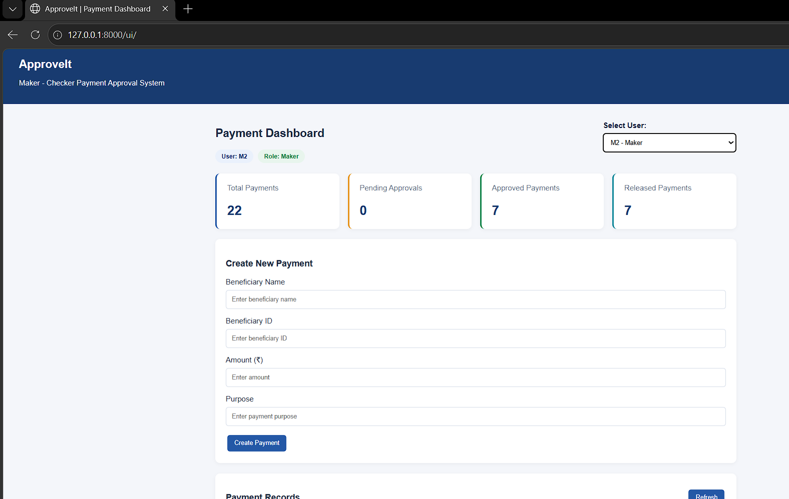
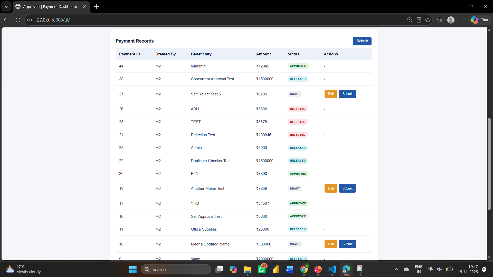
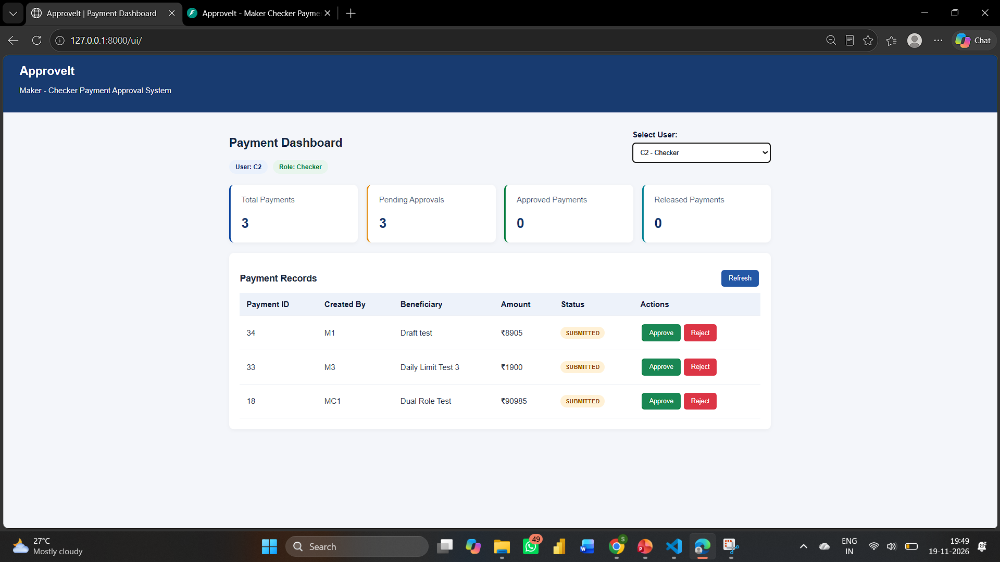
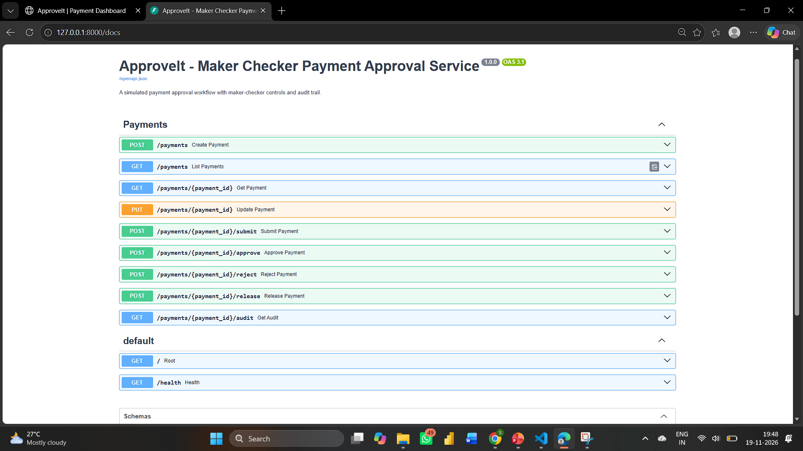
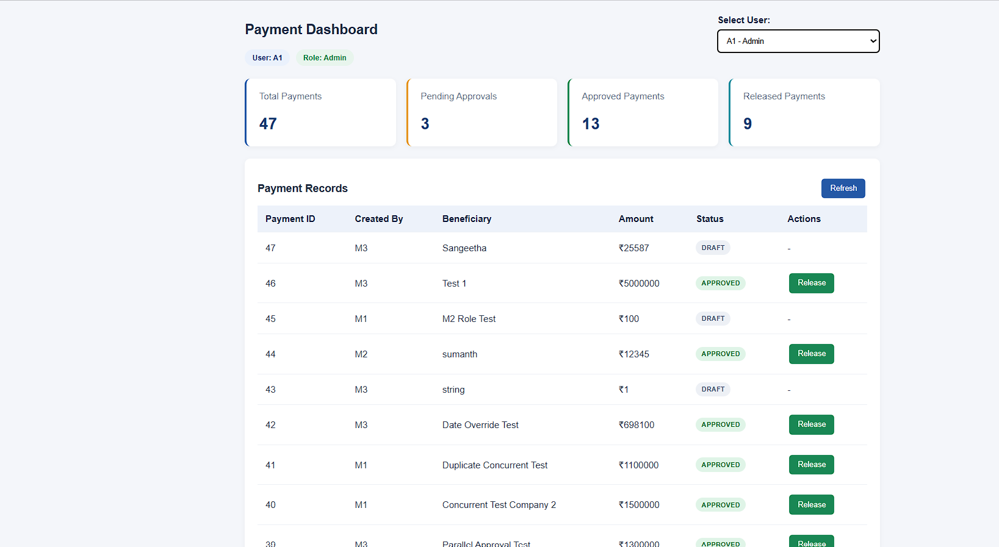
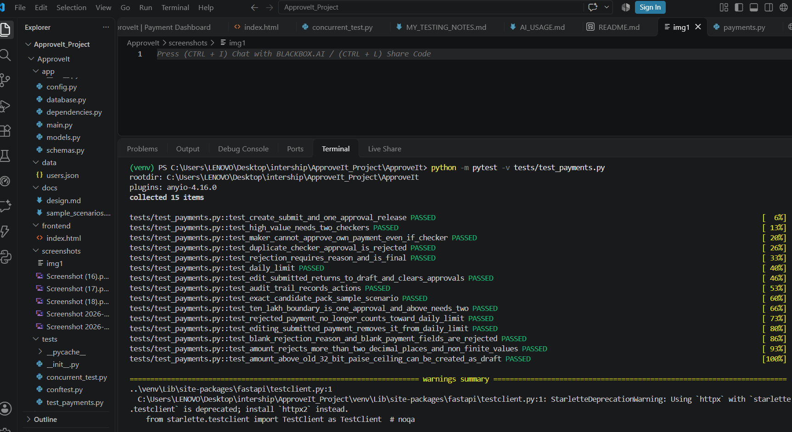

# ApproveIt – Maker-Checker Payment Approval Service

A REST API that simulates controlled payment creation, review, approval and release. No real money is transferred.

## Technology
- Python 3.10+
- FastAPI
- SQLAlchemy 2
- SQLite
- Pytest

## Setup and run (5 commands)
```powershell
python -m venv venv
.\venv\Scripts\Activate.ps1
pip install -r requirements.txt
uvicorn app.main:app --reload
pytest -v
```
Open http://127.0.0.1:8000/docs for interactive API documentation.

## Demo users
These are the ten users supplied in the company candidate pack. The included `data/users.json` is copied from the company candidate pack. The loader accepts its top-level `users` array and each user's `id` field.

| User ID | Roles |
|---|---|
| M1, M2, M3 | Maker |
| C1, C2, C3 | Checker |
| MC1, MC2 | Maker, Checker |
| A1, A2 | Admin |

Send `X-User-Id` on every request. This is the assignment's simple identity mechanism, not production authentication.

## Main endpoints
- `POST /payments` – create
- `GET /payments` – list permitted payments
- `GET /payments/{id}` – details
- `PUT /payments/{id}` – edit draft/submitted payment
- `POST /payments/{id}/submit` – submit
- `POST /payments/{id}/approve` – approve
- `POST /payments/{id}/reject` – reject with reason
- `POST /payments/{id}/release` – admin release
- `GET /payments/{id}/audit` – audit trail

## Example create request
Header: `X-User-Id: M1`

```json
{
  "beneficiary_name": "ABC Technologies",
  "beneficiary_id": "BEN001",
  "amount": 1500000,
  "purpose": "Vendor payment"
}
```

The amount is INR. Amounts are stored internally as integer paise.

## Business rules
- Only a Maker can create, edit or submit a payment.
- Only the maker who created the payment can edit or submit it.
- Editing a submitted payment returns it to DRAFT and clears prior reviews.
- A maker cannot review their own payment, even if they also have Checker role.
- Up to and including INR 10,00,000 needs one approval; above that needs two different checkers.
- A checker can review a payment only once.
- Rejection requires a non-blank reason and is final.
- Only Admin can release APPROVED payments.
- Daily maker submission total is capped at INR 50,00,000 using the Asia/Kolkata calendar date. SUBMITTED, APPROVED and RELEASED submissions count; REJECTED and DRAFT do not.
- `X-Test-Date: YYYY-MM-DD` allows deterministic date testing. Set `ALLOW_TEST_DATE_OVERRIDE=false` in the environment to disable it.
- SQLite write transactions are started with `BEGIN IMMEDIATE` before approval-state reads; a unique `(payment_id, checker_id)` constraint prevents duplicate checker decisions.

## Assumptions and design decisions
1. `X-User-Id` identifies the caller because the assignment explicitly says real login is not required.
2. User roles are loaded from `data/users.json` into the users table at startup.
3. Money is stored as integer paise to avoid floating-point precision errors.
4. Release is a status change only; no bank or payment network is contacted.
5. A submitted payment counts toward the maker's daily limit until it is rejected or edited back to DRAFT.
6. The test-date header is intended only for local testing.

## Known limitations
- No password-based authentication or production identity provider.
- SQLite is appropriate for this assignment, but a production multi-instance deployment would normally use PostgreSQL or another server database.
- Audit records are append-only through the application workflow, but the local SQLite file is not cryptographically tamper-proof.
- No frontend, notifications or real payment integration.

## What I would improve with another week
- Add authenticated identity and authorization.
- Add PostgreSQL and integration tests for multi-worker concurrency.
- Add hash-chained audit events and external immutable log storage.
- Add pagination, filtering and a checker work queue.
- Add monitoring, structured logging and deployment configuration.

## Test
Run the automated test suite from the project root:
```powershell
pytest -v
```
The tests use a temporary SQLite database and do not modify the demo database.

## Supplied sample scenario
The original candidate-pack scenario is preserved in [`docs/sample_scenarios.md`](docs/sample_scenarios.md). The automated test suite runs that flow dated `2026-11-16`: M2 creates and submits a ₹25,000 payment, C1 approves it, A1 releases it; M2 then submits a ₹15,00,000 payment, C1 records approval 1 of 2, and M2's attempted approval is refused because M2 is not a Checker.
# ApproveIt – Maker-Checker Payment Approval System

## 1. Project Overview

ApproveIt is a payment approval application developed using Python and FastAPI. It implements a Maker-Checker workflow in which one user creates and submits a payment, different authorized users review it, and an Admin releases it after the required approvals.

The main objective is to prevent unauthorized payment approvals, enforce payment limits, maintain an audit trail and ensure that payment operations follow the defined business rules.

**Note:** Payment release is simulated. No actual money is transferred.

## 2. Technologies Used

| Technology | Purpose |
|---|---|
| Python | Backend programming |
| FastAPI | REST API development |
| SQLAlchemy | ORM and database operations |
| SQLite | Database storage |
| Pydantic | Request validation |
| HTML | Frontend structure |
| CSS | Frontend styling |
| JavaScript | Frontend functionality |
| Pytest | Automated testing |
| Swagger / OpenAPI | API documentation |

## 3. Key Features

- Payment creation, editing and submission by Makers.
- Role-based permissions for Maker, Checker, Maker-Checker and Admin users.
- Ownership-based payment editing and submission.
- Prevention of Maker self-approval and self-rejection.
- One Checker approval for payments up to and including ₹10 lakh.
- Two different Checker approvals for payments above ₹10 lakh.
- Prevention of duplicate Checker decisions.
- Daily submission limit of ₹50 lakh per Maker, calculated using the IST calendar day.
- Mandatory rejection reason.
- Payment status validation throughout the lifecycle.
- Audit logging of payment activities and state changes.
- Database transaction handling for concurrent approval operations.
- Role-aware frontend actions.
- Interactive API documentation through Swagger UI.

## 4. System Architecture

The application follows a layered architecture.

### Frontend Layer
- Developed using HTML, CSS and JavaScript.
- Provides the interface for Makers, Checkers and Admins.
- Communicates with the backend through REST APIs.

### Backend Layer
- Developed using Python and FastAPI.
- Handles API requests and user identification.
- Validates roles, ownership and payment status.
- Applies payment approval rules and business logic.
- Manages audit records and database transactions.

### Database Layer
- Uses SQLite for persistent data storage.
- Uses SQLAlchemy as the ORM.
- Stores users, payments, Checker reviews and audit logs.

The frontend communicates with FastAPI through HTTP requests. The backend uses SQLAlchemy to interact with SQLite.

## 5. Database Design

The application uses four main database tables:

| Table | Purpose |
|---|---|
| `users` | Stores user details and roles |
| `payments` | Stores payment information and current status |
| `payment_reviews` | Stores Checker approval and rejection decisions |
| `audit_logs` | Stores payment activity and state-change history |

### Database Relationships

- One user can create multiple payments.
- One user can perform multiple Checker reviews.
- One user can generate multiple audit records.
- One payment can have multiple Checker reviews.
- One payment can have multiple audit records.

Primary keys and foreign keys maintain the relationships between these tables.

A unique constraint on `(payment_id, checker_id)` prevents the same Checker from reviewing the same payment more than once.

## 6. Payment Workflow

The payment follows these stages:

1. **DRAFT:** The Maker creates a payment.
2. **SUBMITTED:** The Maker submits the payment for review.
3. **Checker Review:** An eligible Checker approves or rejects the payment.
4. **APPROVED:** The required number of Checker approvals is completed.
5. **RELEASED:** The Admin releases the approved payment.

### Approval Rules

| Payment Amount | Required Approvals |
|---|---|
| Up to and including ₹10,00,000 | 1 Checker |
| Above ₹10,00,000 | 2 different Checkers |

### Rejection Rules

- Only an authorized Checker can reject a submitted payment.
- The Maker cannot reject their own payment.
- A rejection reason is mandatory.
- A rejected payment moves to the final `REJECTED` state.

### Editing Rules

If the Maker edits a submitted payment, it returns to `DRAFT`. Previous Checker reviews are cleared so that the updated payment can be reviewed again.

## 7. Assumptions

1. The assignment uses `X-User-Id` as a simplified way to identify the current user.
2. User details and roles are loaded from `data/users.json`.
3. Users can have more than one role, such as Maker and Checker.
4. A Maker cannot approve or reject their own payment, even if they also have the Checker role.
5. Payment amounts must be greater than zero and can have a maximum of two decimal places.
6. The daily submission limit is calculated separately for each Maker using the IST calendar day.
7. Rejected payments and payments returned to `DRAFT` do not count towards the daily submission limit.
8. Rejected and released payments are treated as final states.
9. Payment release is simulated and does not connect to an actual banking system.

## 8. Key Design Decisions

### 8.1 FastAPI for Backend Development
FastAPI was selected to build REST APIs, validate requests and provide automatic OpenAPI documentation.

### 8.2 SQLite with SQLAlchemy
SQLite provides persistent database storage, while SQLAlchemy makes database operations easier through Python models and ORM functionality.

### 8.3 Separate Payment Review Table
Checker decisions are stored separately from payment information. This supports multiple Checker approvals for a single payment and maintains individual decision records.

### 8.4 Store Amounts in Paise
Payment amounts are stored as integer paise instead of floating-point numbers to avoid precision and rounding issues.

### 8.5 Role-Based Authorization
The backend checks the user's role, payment ownership and current payment status before allowing an operation.

### 8.6 Database Transaction Handling
SQLite write transactions use `BEGIN IMMEDIATE` to serialize competing write operations. A unique constraint on payment and Checker IDs provides additional protection against duplicate decisions.

### 8.7 Audit Logging
Important payment operations generate audit records containing the acting user, action, timestamp, previous state and resulting state.

## 9. Setup and Run Instructions

### Requirements

- Python 3.10 or later.
- pip package manager.
- Windows, Linux or macOS.

### Windows PowerShell Setup

Run these commands from the project root directory (the folder containing `app`, `frontend` and `requirements.txt`).

**Command 1 – Navigate to the project folder**

```powershell
cd path\to\ApproveIt
```

**Command 2 – Create a virtual environment**

```powershell
py -m venv venv
```

**Command 3 – Activate the virtual environment**

```powershell
.\venv\Scripts\Activate.ps1
```

**Command 4 – Install dependencies**

```powershell
python -m pip install -r requirements.txt
```

**Command 5 – Start the application**

```powershell
python -m uvicorn app.main:app --reload
```

The application creates the required database tables and loads the demo users during startup.

If PowerShell blocks virtual-environment activation, run this once in the current terminal and activate again:

```powershell
Set-ExecutionPolicy -Scope Process -ExecutionPolicy Bypass
.\venv\Scripts\Activate.ps1
```

### Application URLs

| Application | URL |
|---|---|
| Frontend | http://127.0.0.1:8000/ui/ |
| Swagger UI | http://127.0.0.1:8000/docs |
| ReDoc | http://127.0.0.1:8000/redoc |
| OpenAPI JSON | http://127.0.0.1:8000/openapi.json |
| Health Check | http://127.0.0.1:8000/health |

## 10. Demo Users

The application loads the following synthetic users from `data/users.json`.

| User ID | Role |
|---|---|
| M1, M2, M3 | Maker |
| MC1, MC2 | Maker and Checker |
| C1, C2, C3 | Checker |
| A1, A2 | Admin |

For API requests, provide the `X-User-Id` header to identify the user.

Example:

```http
X-User-Id: M1
```

This is a simplified identity mechanism for the assignment, not production authentication.

## 11. API Documentation

FastAPI automatically generates OpenAPI documentation for the application.

Swagger UI:

http://127.0.0.1:8000/docs

ReDoc:

http://127.0.0.1:8000/redoc

OpenAPI JSON:

http://127.0.0.1:8000/openapi.json

### Main API Endpoints

All endpoints require the appropriate `X-User-Id` header.

| HTTP Method | Endpoint | Description |
|---|---|---|
| POST | `/payments` | Create a payment |
| GET | `/payments` | List payments visible to the user |
| GET | `/payments?status=SUBMITTED` | Filter payments by status |
| GET | `/payments/{payment_id}` | Get payment details |
| PUT | `/payments/{payment_id}` | Edit a payment |
| POST | `/payments/{payment_id}/submit` | Submit a payment |
| POST | `/payments/{payment_id}/approve` | Approve a payment |
| POST | `/payments/{payment_id}/reject` | Reject a payment |
| POST | `/payments/{payment_id}/release` | Release an approved payment |
| GET | `/payments/{payment_id}/audit` | View payment audit history |

### Example 1: Create a Payment

**Request**

```http
POST /payments
X-User-Id: M1
Content-Type: application/json
```

**Request Body**

```json
{
  "beneficiary_name": "ABC Technologies",
  "beneficiary_id": "BEN001",
  "amount": 1500000.00,
  "purpose": "Vendor payment"
}
```

The API creates a payment with the initial status `DRAFT`.

### Example 2: Submit a Payment

```http
POST /payments/1/submit
X-User-Id: M1
```

The payment changes from `DRAFT` to `SUBMITTED` if the Maker owns it and the daily submission limit is not exceeded.

### Example 3: Approve a Payment

```http
POST /payments/1/approve
X-User-Id: C1
```

The API records the Checker decision and returns the payment's current status, approvals received and approvals required.

### Example 4: Reject a Payment

```http
POST /payments/1/reject
X-User-Id: C1
Content-Type: application/json
```

**Request Body**

```json
{
  "reason": "Incorrect beneficiary details"
}
```

A rejection reason is required. The payment status changes to `REJECTED`.

### Example 5: Release a Payment

```http
POST /payments/1/release
X-User-Id: A1
```

Only an Admin can release an approved payment. The payment status changes to `RELEASED`.

### Example 6: View Audit History

```http
GET /payments/1/audit
X-User-Id: A1
```

The API returns the recorded payment actions, user IDs, timestamps and state changes.

### Test Date Override

For testing date-dependent rules, the application supports the optional `X-Test-Date` header.

Example:

```http
X-Test-Date: 2026-11-16
```

The date must use the `YYYY-MM-DD` format.

The `ALLOW_TEST_DATE_OVERRIDE` setting defaults to `true` in this project. It can be disabled by setting the environment variable to `false`.

## 12. Testing

The project uses Pytest for automated payment testing.

### Run the payment tests

```powershell
python -m pytest -v tests/test_payments.py
```

The payment test module contains 15 tests covering:

- Payment creation and lifecycle.
- Approval threshold rules.
- Maker self-approval prevention.
- Duplicate Checker approval prevention.
- Payment rejection.
- Daily submission limit.
- Editing and approval reset.
- Audit history.
- Input and amount validation.

### **Concurrency Testing**

A separate concurrency test script is available at:

```
tests/concurrent_test.py
```

This test checks how the application handles simultaneous Checker approval requests for the same payment.

It sends concurrent approval requests using multiple threads. This helps verify that competing approval operations do not create duplicate Checker decisions or incorrectly update the payment status.

**How to run the concurrency test:**

**Terminal 1 – Start the FastAPI server**

Open the first terminal in the project root and run:

```
.\venv\Scripts\Activate.ps1
```

```
python -m uvicorn app.main:app --reload
```

Keep this terminal running.

**Terminal 2 – Execute the concurrency test**

Open a second terminal in the same project root and run:

```
.\venv\Scripts\Activate.ps1
```

```
python tests/concurrent_test.py
```

If the `requests` package is not installed, install it in the second terminal:

```
python -m pip install requests
```

**Important:** The concurrency script currently uses a fixed payment ID. Before running it, make sure that the payment ID exists, is in the `SUBMITTED` state, and is eligible for the concurrent approval test. Use a fresh submitted payment or update the payment ID in the script when necessary.

**Note:** This is a separate manual HTTP concurrency test, not part of the 15 automated Pytest tests. The script should be adjusted to use fresh test data, and its dependency should be declared in `requirements.txt` before treating it as a repeatable automated test.

The concurrency script also needs to be separated from normal Pytest collection if it executes HTTP requests when imported.


## 13. Known Limitations

1. `X-User-Id` is used for simplified user identification. Production authentication and token-based authorization are not implemented.
2. SQLite is suitable for this assignment and local demonstration, but PostgreSQL would be more suitable for a larger multi-user production deployment.
3. Payment release is simulated. No actual bank integration or money transfer is performed.
4. The application does not automatically verify beneficiary bank details or detect fraud. The Checker manually reviews payment information.
5. Audit entries are append-only through the application workflow, but cryptographic tamper detection is not implemented.
6. The frontend is a simple demonstration interface and does not include every advanced banking feature.
7. Pagination, notifications and pending-payment alerts are not currently implemented.
8. The concurrency test script needs improvements before it can be included in the normal automated pytest suite.

## 14. What I Would Do With Another Week

If I had another week to improve this project, I would:

- Implement secure authentication and token-based authorization.
- Improve automated concurrency testing using isolated test data.
- Add PostgreSQL support for larger deployments.
- Implement tamper-evident audit logging.
- Add payment search, filtering and pagination.
- Add notifications for pending Checker approvals.
- Add alerts for payments pending longer than 24 hours.
- Improve application logging, error handling and deployment configuration.

## 15. Application Screenshots

Screenshots are included to demonstrate the working frontend and API functionality.

All project screenshots are stored in the screenshots/ folder in the project root.

The following screenshots demonstrate the main application features:


### Main Dashboard



### Recorded Table



### Checker Dashboard



### Swagger API Documentation



### Admin Dashboard



### Automated Test Results



## 16. Project Documents

- `docs/design.md` – System architecture, database design, workflow and technical decisions.
- `docs/sample_scenarios.md` – Sample payment scenarios.
- `AI_USAGE.md` – AI tools used and how they assisted during development.
- `MY_TESTING_NOTES.md` – Personal testing commands and manual verification notes.

## 17. Submission Note

The project repository should include the `.git` folder when submitting the repository as a ZIP file, so that the commit history remains visible.

Do not remove the `.git` folder while preparing the final submission.

---

**Project:** ApproveIt – Maker-Checker Payment Approval System  
**Backend:** Python and FastAPI  
**Database:** SQLite with SQLAlchemy  
**Frontend:** HTML, CSS and JavaScript