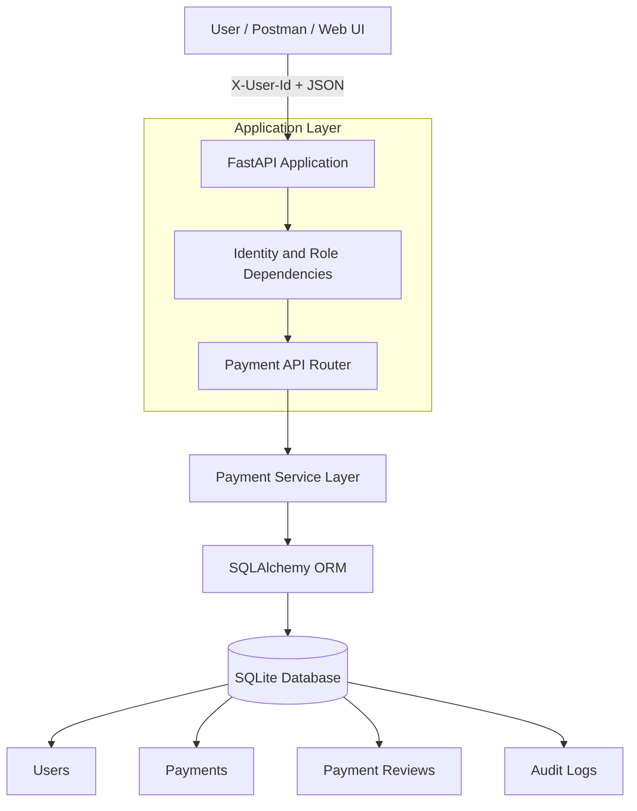
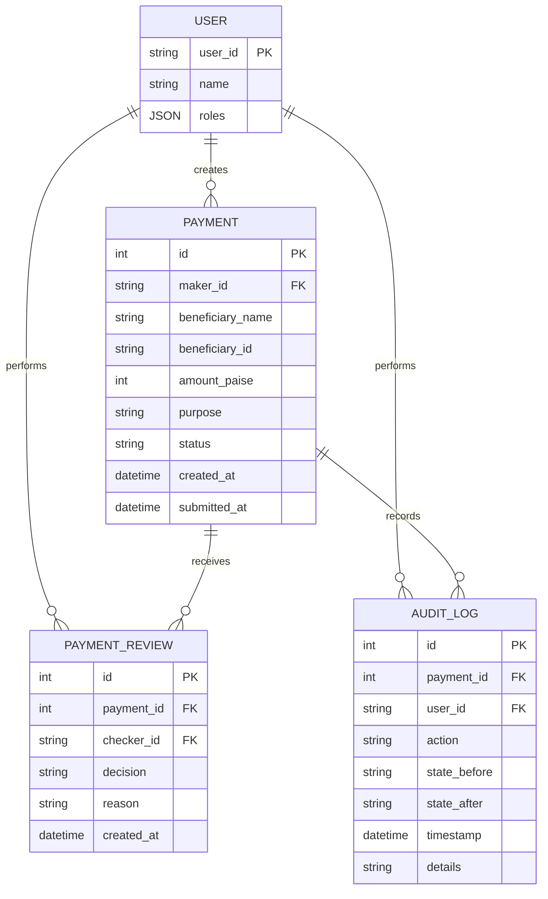
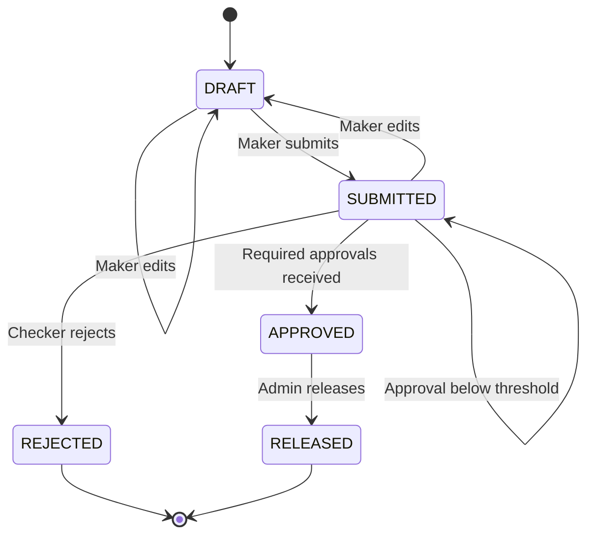

# ApproveIt – System Design Document

## 1. Project Overview

ApproveIt is a role-based payment approval system built around the Maker-Checker principle. It ensures that payment requests are created, reviewed and released only by authorized users.

The system separates payment creation from payment approval to prevent unauthorized self-approval. It enforces approval thresholds, daily submission limits, controlled payment lifecycle transitions and a traceable audit history.

Payment release is simulated. The application does not perform actual bank transfers.

## 2. System Architecture

ApproveIt follows a layered architecture that separates API handling, identity verification, business logic and database operations.

### Architecture Diagram

### Component Responsibilities

- **Client Layer:** Provides access through the web interface, Swagger UI and API clients such as Postman.
- **FastAPI Application:** Exposes REST endpoints and handles incoming HTTP requests.
- **Identity and Role Dependencies:** Identify the current user and provide role information for authorization.
- **Payment Router:** Handles payment API requests, request validation and communication with the service layer.
- **Payment Service:** Implements the core business rules, including payment lifecycle transitions, approval requirements, daily limits and audit operations.
- **SQLAlchemy ORM:** Handles database interactions between application objects and database tables.
- **SQLite:** Provides persistent storage for users, payments, checker decisions and audit records.

This separation keeps business logic independent of the client interface and makes the application easier to test and maintain.

## 3. Database Design

The application uses SQLite with SQLAlchemy for persistent storage. The database contains four main tables: `users`, `payments`, `payment_reviews` and `audit_logs`.

### Tables and Responsibilities

| Table | Responsibility |
|---|---|
| `users` | Stores synthetic assignment users and their roles |
| `payments` | Stores payment details and current lifecycle status |
| `payment_reviews` | Stores individual Checker approval or rejection decisions |
| `audit_logs` | Stores the history of actions performed on payments |

### Primary Keys and Foreign Keys

| Table | Primary Key | Foreign Keys |
|---|---|---|
| `users` | `user_id` | None |
| `payments` | `id` | `maker_id` → `users.user_id` |
| `payment_reviews` | `id` | `payment_id` → `payments.id`; `checker_id` → `users.user_id` |
| `audit_logs` | `id` | `payment_id` → `payments.id`; `user_id` → `users.user_id` |

### Entity Relationship Diagram

### Data Design Decisions

- **User:** Represents predefined synthetic users and their assigned roles. `user_id` is the primary key.
- **Payment:** Stores the current payment state. `id` is the primary key, and `maker_id` references the user who created the payment. The payment amount is stored as an integer number of paise to avoid floating-point precision issues.
- **PaymentReview:** Stores Checker decisions separately from the main payment record. `payment_id` references the reviewed payment, while `checker_id` references the Checker who made the decision. A unique constraint on `(payment_id, checker_id)` prevents the same Checker from recording multiple decisions for the same payment.
- **AuditLog:** Maintains a historical record of payment operations. `payment_id` references the related payment, and `user_id` references the user who performed the action. Each record includes the action, previous state, resulting state, timestamp and relevant details.

The `Payment` table represents the current state, while `PaymentReview` and `AuditLog` preserve the decisions and history behind that state.

The live SQLite schema was inspected and its four tables, primary keys, foreign-key relationships and the unique index on `(payment_id, checker_id)` matched the SQLAlchemy model definitions.

## 4. Payment Lifecycle

A payment follows controlled state transitions.

### Lifecycle Rules

1. A Maker creates a payment in `DRAFT`.
2. Only the Maker who created the payment can edit it while it is in `DRAFT`.
3. The owning Maker submits the payment for review.
4. Eligible Checkers review submitted payments. A Maker cannot approve or reject their own payment, even if they also have Checker permissions.
5. Payments up to and including INR 10,00,000 require one distinct Checker approval.
6. Payments above INR 10,00,000 require two distinct Checker approvals.
7. A valid rejection requires a reason and moves the payment to the final `REJECTED` state.
8. An Admin releases an `APPROVED` payment, moving it to `RELEASED`.

Editing a submitted payment returns it to `DRAFT` and clears its existing review decisions. The edit action remains recorded in the audit history.

Rejected and released payments are final states and cannot continue through the approval lifecycle.

## 5. Key Business Controls

### 5.1 Role-Based Authorization

Each operation checks the caller's identity, assigned role, payment ownership and current payment status.

The application supports Maker, Checker, Maker-Checker and Admin roles. Having multiple roles does not bypass the restriction against reviewing one's own payment.

### 5.2 Daily Submission Limit

Each Maker has a maximum submission limit of INR 50,00,000 per calendar day.

- The calculation uses the Asia/Kolkata (IST) calendar date.
- Each Maker has an independent daily limit.
- Rejected payments and payments returned to `DRAFT` are excluded from the daily total.
- The test-date override allows date-dependent rules to be tested without changing the system clock.

This is a calendar-day restriction, not a rolling 24-hour calculation.

### 5.3 Money Precision and Validation

Payment amounts are stored as integer paise instead of floating-point values. This avoids rounding errors during financial calculations.

The API validates positive amounts, limits decimal precision to two places and checks required payment fields.

### 5.4 Concurrent Approval Safety

Multiple Checkers may attempt to approve the same payment at nearly the same time.

To protect the approval count, the service uses SQLite's `BEGIN IMMEDIATE` transaction before reading and modifying approval state.

This serializes competing database writers. The unique `(payment_id, checker_id)` constraint provides an additional safeguard against duplicate Checker decisions.

The payment status changes to `APPROVED` only when the required number of distinct approvals has been received.

### 5.5 Audit Trail

Important payment operations generate audit records containing the acting user, action, previous state, resulting state, timestamp and relevant details.

Audit entries are created in the same database transaction as the associated operation. This prevents a successful audit entry from being committed when the corresponding operation fails.

The audit history is designed to be append-only through application operations.

## 6. Assumptions and Design Decisions

- The `data/users.json` file contains the synthetic assignment users and roles. These users are loaded into the database during application startup.
- `X-User-Id` is used as a development identity mechanism to simulate different users. It is not intended as production authentication.
- SQLite is sufficient for the assignment's persistence requirements and local execution.
- Payment release is simulated; no actual funds are transferred.
- Rejected and released payments are treated as final states.
- The service layer enforces business rules so that the same controls apply regardless of whether requests originate from Swagger, Postman or the web interface.

## 7. Testing and Reliability

The implementation has been verified through automated payment tests and a separate concurrent approval test.

The automated payment test suite covers:

- Payment creation and lifecycle transitions.
- Approval thresholds and distinct Checker validation.
- Maker self-approval prevention.
- Rejection and duplicate decision handling.
- Daily submission limits and excluded payments.
- Editing and approval reset.
- Audit trail generation.
- Amount and input validation.

**Verified test results:**

- 15 payment tests passed using `python -m pytest -v tests/test_payments.py`.
- A separate concurrent approval scenario was executed successfully, verifying duplicate prevention and distinct Checker approvals.

The full pytest suite still needs its concurrent test file to be structured for safe collection and execution through pytest.

## 8. Future Improvements

Possible extensions beyond the assignment's core requirements include:

- Production-grade authentication and token-based authorization.
- Checker notifications and pending-payment alerts.
- Tamper-evident audit records.
- Advanced payment search and pagination.
- Migration to PostgreSQL for a larger multi-user deployment.